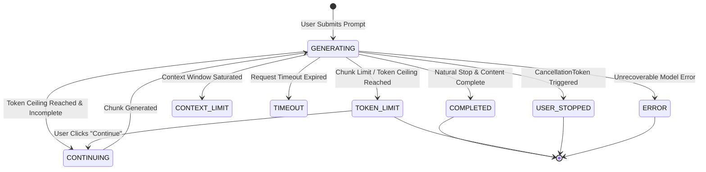

# M11.5 Response Reliability & Long-Answer Delivery Architecture

## 1. Executive Summary

Milestone M11.5 introduces a dedicated, high-reliability response subsystem (`src/response/`) to solve the challenge of silent AI response truncation, incomplete code snippets, and fragmented security explanations on local hardware. 

Prior to M11.5, when a local model reached an internal generation ceiling (such as `num_predict` or context boundaries), generation ceased abruptly. The frontend frequently misreported the truncated output as "complete," cutting off critical proof-of-concept scripts, HTTP request traces, and vulnerability impact analyses.

M11.5 eliminates silent truncation by treating response generation as a multi-turn, stateful session that distinguishes natural model completion (`done_reason: stop`) from forced token termination (`done_reason: length`). It introduces conservative completeness detection, deterministic suffix-prefix overlap elimination, persistent chunk provenance, and safe streaming cancellation.

---

## 2. High-Level Architecture

The Long Response Subsystem operates between the core investigation layer and the model inference provider:

```mermaid
flowchart TD
    User([User Prompt / Action]) --> AppService[Dashboard Service]
    AppService --> Engine[LongResponseEngine]
    
    subgraph ResponseSubsystem ["Long Response Subsystem (src/response/)"]
        Engine --> StreamHandler[ResponseStreamHandler / CancellationToken]
        StreamHandler --> LLMCaller[Ollama Inference Caller]
        LLMCaller --> RawChunk[Raw Response Chunk]
        RawChunk --> Completeness[CompletenessDetector]
        RawChunk --> Merger[ResponseMerger]
        Merger --> SuffixOverlap[Suffix/Prefix & Sentence Overlap Stripper]
        SuffixOverlap --> CleanChunk[Cleaned Chunk]
        CleanChunk --> ContextMgr[ContinuationContextManager]
        ContextMgr --> StateCheck{Is Complete or Limit Reached?}
        StateCheck -- Incomplete & Under Limit --> NextPrompt[Build Continuation Context]
        NextPrompt --> LLMCaller
        StateCheck -- Complete or Limit --> Finalizer[Session Finalizer]
        Finalizer --> Persistence[(SQLite Response Persistence)]
        Finalizer --> Telemetry[ResponseTelemetry]
    end
    
    Persistence --> API[/api/responses/* Endpoints]
    API --> Frontend[LargeResponseView UI]
```

---

## 3. Subsystem Components

The subsystem is organized in `src/response/`:

| Module | Responsibility | Key Abstractions |
| :--- | :--- | :--- |
| `models.py` | Typed dataclasses and Pydantic models for response sessions, chunks, statuses, and terminations | `ResponseSession`, `ResponseChunk`, `ResponseVersion`, `ResponseStatus`, `GenerationTermination` |
| `errors.py` | Explicit typed exceptions for response and continuation lifecycle | `ResponseEngineError`, `ContinuationLimitError`, `OverlapDetectionError` |
| `generator.py` | Master orchestrator coordinating generation loops, automatic continuation, and regeneration | `LongResponseEngine` |
| `completeness.py` | Multi-signal syntactic and semantic evaluation of response completeness | `CompletenessDetector`, `CompletenessEvaluation`, `CompletenessState` |
| `merger.py` | Deterministic suffix-prefix and sentence overlap detection and stripping | `ResponseMerger`, `OverlapDetectionResult` |
| `continuation.py` | Framing continuation directives with exact tail context while enforcing cumulative limits | `ContinuationContextManager` |
| `stream.py` | Safe SSE/chunked streaming event handling with deterministic cancellation tokens | `CancellationToken`, `ResponseStreamHandler`, `StreamEvent` |
| `persistence.py` | SQLite persistence for sessions, chunks, and version history | `ResponsePersistence` |
| `metrics.py` | Structured telemetry tracking token counts, latency, and terminations without secret leakage | `ResponseTelemetry` |

---

## 4. State Machine & Termination Taxonomy

### 4.1 Response Status Lifecycle

A `ResponseSession` progresses through explicit lifecycle states:



### 4.2 Explicit Termination Reason Taxonomy

Never treat `TOKEN_LIMIT` as `COMPLETED`. The engine records explicit termination reasons (`GenerationTermination`):
- `NATURAL_STOP`: Model signaled stop and completeness heuristics verify finished syntax.
- `LENGTH_CEILING`: Model reached chunk `num_predict` or max token ceiling.
- `CHUNK_LIMIT`: Session reached configured `MAX_CONTINUATION_CHUNKS`.
- `TOKEN_CEILING`: Cumulative session tokens reached `MAX_CUMULATIVE_TOKENS`.
- `USER_ABORT`: User clicked "Stop Generating".
- `TIMEOUT_EXPIRED`: Generation exceeded configured deadline.
- `ERROR`: Model exception or network failure.

---

## 5. Completeness Detection Pipeline

Rather than relying on a single heuristic (such as checking for a trailing period), `CompletenessDetector` analyzes multiple independent signals:

1. **Model Stop Reason**: Evaluates whether Ollama reported `stop` vs `length`.
2. **Code Fence Parity**: Tracks triple-backtick (```` ``` ````) fences. An odd count confirms mid-block truncation.
3. **Markdown Structural Continuity**: Detects incomplete markdown headings (`## ` at the end of line) and unfinished ordered/unordered list markers (`1. `, `- `).
4. **Bracket and Delimiter Balance**: Computes balance counters for `{...}`, `[...]`, and `(...)` across code and JSON payloads.
5. **Dangling Delimiters & Tables**: Detects dangling colons (`:`) indicating an impending list or block, unclosed pipe tables (`| Endpoint |`), and trailing commas/dashes.
6. **Sentence Boundaries**: Checks whether text concludes on valid terminal punctuation (`.`, `!`, `?`, `"""`, `)`) vs mid-word/mid-sentence cutoff.

---

## 6. Overlap Detection & Merger Mechanics

When a model is asked to "continue from where you left off," it frequently repeats the last sentence or introductory clause. `ResponseMerger` eliminates this duplication deterministically:

1. **Meta Preface Stripping**: Strips boilerplate phrases like `"Here is the continuation:"`, `"Continuing from above:"`, or `"Resuming from interruption:"`.
2. **Exact Suffix-Prefix Matching**: Searches a bounded window (up to 400 characters) between the tail of the accumulated text and the head of the new chunk. If an exact overlap of $\ge 4$ characters is found, the duplicate prefix is excised.
3. **Sentence-Level Deduplication**: If the model regenerates the entirety of the last completed sentence ($\ge 15$ characters), the merger identifies the duplicate sentence and joins the stream cleanly.
4. **Whitespace Normalization**: Resolves mismatched trailing newlines without breaking markdown formatting.
5. **Raw Content Preservation**: The un-sanitized, un-merged model output is preserved in `ResponseChunk.raw_content` with cryptographic SHA-256 hashes (`content_hash`) to ensure forensic replayability.

---

## 7. Hardware Profile & Resource Budget

The architecture is tuned specifically for local workstation constraints:

| Resource | Specification | Allocation / Budget |
| :--- | :--- | :--- |
| **CPU** | AMD Ryzen 5 5600H (6 cores, 12 threads) | Syntactic parsing, regex matching, SQLite operations |
| **System RAM** | 24 GB DDR4 | Bounded streaming ring buffers (< 16 MB max per response) |
| **GPU / VRAM** | NVIDIA GeForce RTX 3050 Laptop GPU (4 GB VRAM) | Single-concurrency Ollama inference (`Qwen 2.5 Coder 7B / 3B`) |
| **Max Concurrent Inference** | 1 | Strictly serialized generation to prevent CUDA OOM |
| **Default Chunk Tokens** | 512 tokens | Optimal latency-per-chunk on 4GB VRAM GPU |
| **Max Cumulative Tokens** | 4,096 tokens | Safe ceiling preventing context drift |
| **Max Continuation Chunks**| 8 chunks | Upper bound on automated recovery loops |
