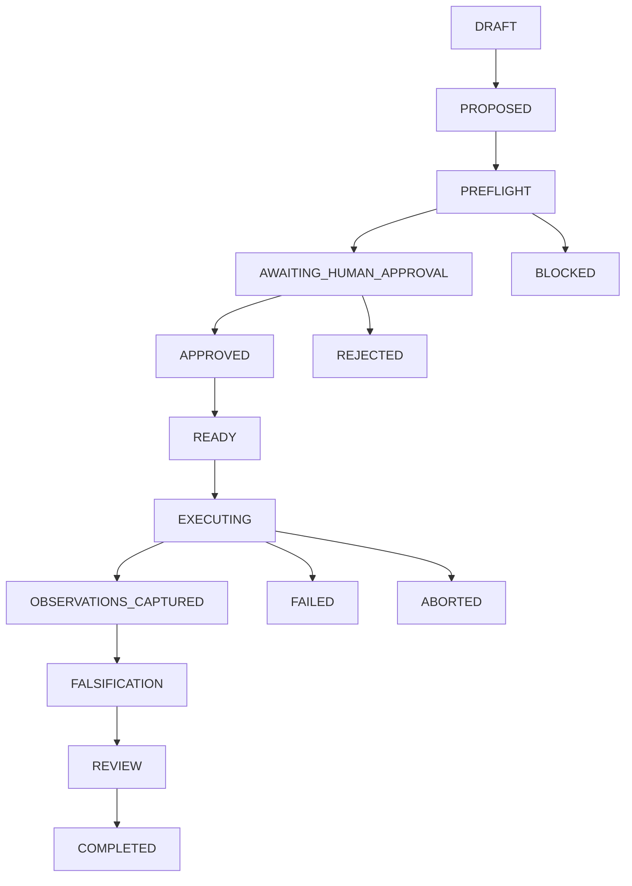

# M11: Controlled Security Experiment and Safe PoC Engine

## 1. Executive Summary
Milestone 11 introduces a deterministic Controlled Security Experiment System and a Safe Proof-of-Concept (PoC) Engine for the Local AI-Assisted Bug Bounty Research Platform. The engine acts as a rigorous verification assistant bridging hypothesis formulation and evidence validation while strictly prohibiting autonomous weaponized exploitation. By establishing two distinct execution planes (Plane A: Isolated Local Lab vs Plane B: Authorized Real Target), deterministic preflight safety checks, cryptographically bound human approval tokens, differential negative controls, and direct integration with the authoritative `FindingValidator`, M11 guarantees that security hypotheses are safely, reproducibly, and objectively verified without risking target infrastructure or operational integrity.

---

## 2. M10.5 Baseline
Prior to M11, the platform achieved checkpoint `v10.5.0-repository-clean` (commit `75a0a1a`), with:
- Zero repository hygiene defects, zero orphaned test artifacts, and zero sensitive credentials in history.
- Explicit `.gitattributes` LF normalization protecting cryptographic hash chains.
- Strict module boundaries separating Core, Database, Scope, Ingestion, Assessment, Agents, Review, Reporting, Audit, and Evaluation.
- Complete regression suite of 1,435 passing tests with zero failures.

---

## 3. M11 Objectives
1. Provide a deterministic bridge:
   $$\text{Hypothesis} \to \text{Evidence Check} \to \text{Experiment Design} \to \text{Preflight} \to \text{Human Approval} \to \text{Execution} \to \text{Observation} \to \text{Negative Control} \to \text{Falsification} \to \text{Review} \to \text{Finding Validation}$$
2. Implement strict Two-Plane Execution Model (Plane A for local isolated fixtures; Plane B for authorized real targets where execution is strictly manual / plan-only).
3. Establish Proof of Condition over Full Exploitation: benign canaries, minimal impact, high evidentiary quality.
4. Enforce 20 hard security invariants (`INV-M11-01` to `INV-M11-20`) with zero violations.
5. Provide isolated lab execution with disposable environments, network loopback restrictions, and automated rollback.
6. Benchmark against 355 deterministic evaluation cases and an 8-track ablation study.

---

## 4. Threat Model
The M11 subsystem operates under an adversarial threat model addressing:
- **Autonomous Weaponization**: Unauthorized attempts by model agents to deploy reverse shells, persistence mechanisms, or credential dumps.
- **Scope Creep / Target Drift**: LLM output proposing or executing requests outside authorized hostnames, ports, or protocols.
- **Identity Forgery**: AI/model identities masquerading as human researchers to bypass approval gates.
- **Untrusted Output / Observation Fabrication**: Model synthesizing or hallucinating observation responses to force hypothesis confirmation.
- **Adversarial Prompt Injection**: Malicious input strings in HTTP responses or source artifacts instructing the agent to ignore safety policies or disable sandboxing.
- **Secret Leakage**: Accidental leakage of bearer tokens, API keys, or cookies into LLM context windows or shared logs.

---

## 5. Experiment Architecture
The experiment domain is anchored by `ControlledExperiment` (`src/experiment/models.py`), maintaining:
- `experiment_id`, `assessment_id`, `hypothesis_id`, `target_id`, `asset_id`.
- `execution_plane`: `PLANE_A_LOCAL_LAB` vs `PLANE_B_AUTHORIZED_TARGET`.
- `environment_type`: `LOCAL_LAB`, `SYNTHETIC_FIXTURE`, `ISOLATED_CONTAINER`, `DISPOSABLE_PROCESS`, `ANDROID_STATIC_TEST`, `AUTHORIZED_TARGET`.
- `authorization_reference`, `scope_reference`, `risk_level`, `status`.
- `preconditions`, `proposed_actions`, `expected_observations`, `negative_controls`, `safety_constraints`.
- `rollback_plan`, `human_approval`, `execution_token`, `execution_record`.
- `observation_ids`, `evidence_ids`, `falsification_result`, `replay_records`.

---

## 6. Safe PoC Architecture
The `SafePoC` specification (`src/experiment/poc.py`) codifies the "Proof of Condition" philosophy:
- Focuses on proving security boundaries (e.g. status code changes, benign reflections, parser boundary checks) rather than destructive payloads.
- Requires unique benign `canary_marker` strings (e.g. `CANARY_M11_...`).
- Validated via `SafePoCValidator` which deterministically rejects:
  - Destructive commands (`rm -rf`, `DROP TABLE`, `mkfs`, `format`, `shred`).
  - Persistence mechanisms (`crontab`, `authorized_keys`, Registry `Run` keys, `schtasks`, `backdoor`).
  - Credential theft (`mimikatz`, `lsass.dmp`, `/etc/shadow`, `pwdump`, `hydra`).
  - Weaponization / reverse shells (`reverse shell`, `nc -e`, `/bin/bash -i`, `/dev/tcp/`, `meterpreter`, `ransomware`).
  - Excessive timeouts (> 60s) or request rates (> 50 requests).

---

## 7. Experiment State Machine
The lifecycle follows a deterministic directed graph managed by `ExperimentStateMachine` (`src/experiment/state_machine.py`):

Terminal sinks (`COMPLETED`, `REJECTED`, `BLOCKED`, `FAILED`, `ABORTED`, `EXPIRED`) have no outbound transitions.

---

## 8. Preflight Safety Engine
`PreflightSafetyEngine` (`src/experiment/preflight.py`) runs 9 sequential checks before any execution:
1. **Prompt Injection Defense** (INV-M11-16): Scans inputs for instruction override patterns.
2. **Safe PoC Validation** (INV-M11-03): Runs `SafePoCValidator` across payload definitions.
3. **Authorization Check** (INV-M11-01): Reuses `AuthorizationValidator` for Plane B; verifies non-revoked reference for Plane A.
4. **Scope Check** (INV-M11-02): Restricts Plane A to loopback hosts; validates Plane B via `ScopeGate`.
5. **Environment Check**: Verifies valid environment enum matching execution plane.
6. **Resource Ceilings** (INV-M11-07): Enforces timeout <= 60s and request limits <= 50.
7. **Risk Classification**: Deterministically assigns `LOW`, `MEDIUM`, `HIGH`, or `BLOCKED`.
8. **Secret Redaction** (INV-M11-15): Traverses actions via `SecretRedactor`.
9. **Decision Matrix**: Outputs `CAN_EXECUTE_LAB`, `AWAITING_HUMAN_APPROVAL`, `PLAN_ONLY`, or `BLOCKED`.

---

## 9. Authorization Controls
- Plane B requires an explicit, active `AuthorizationRecord` with status `AUTHORIZED` within valid timestamps.
- Explicitly revoked or expired records fail closed deterministically.
- Authorization cannot be granted, inferred, or modified by LLM output.

---

## 10. Scope Controls
- Integrates directly with authoritative `ScopeGate`.
- Plane A is strictly pinned to loopback addresses (`127.0.0.1`, `localhost`, `::1`). External target IPs are rejected with `INV-M11-06`.
- Plane B evaluates DNS resolution, TOCTOU rebinding protections, and explicit out-of-scope rules.

---

## 11. Deterministic Risk Model
- **LOW**: Read-only, benign canary reflection, synthetic mock verification.
- **MEDIUM**: Controlled state mutation in disposable local environment (e.g. POST to mock fixture), reversible.
- **HIGH**: Plane B targets, privileged operations, external state mutation.
- **BLOCKED**: Destructive operations, credential dumping, persistence, out-of-scope targets, unauthorized tests.

---

## 12. Controlled Lab Runner (Sandbox)
`ControlledLabRunner` (`src/experiment/lab_runner.py`) provides isolated execution:
- **Disposable Directory**: Creates `tempfile.mkdtemp()` and tears down via `shutil.rmtree()`.
- **Environment Isolation**: Strips sensitive environment variables, passing minimal OS essentials.
- **Network Boundaries**: Enforces loopback-only requests.
- **Output Bounds**: Caps process stdout/stderr at 128 KB.
- **Hard Timeout**: Bounded by PoC timeout ceiling.

---

## 13. Human Approval Gate
`HumanApprovalGate` (`src/experiment/approval.py`):
- Displays all 11 safety parameters before approval.
- Rejects AI/automated identities (`ai`, `system`, `llm`, `agent`, `bot`, `qwen`, `ollama`, `orchestrator`, `auto`) with `HumanApprovalRejectedError` (INV-M11-04).
- Requires attributable human identity string.

---

## 14. Execution Authorization Token
- Generated upon valid human approval (`ExecutionAuthorizationToken`).
- Short-lived (default 300s TTL).
- Cryptographically binds:
  $$\text{SHA-256}(\text{exp\_id} : \text{asm\_id} : \text{target} : \text{actions\_hash} : \text{risk} : \text{approver} : \text{timestamp})$$
- Runner re-verifies action hash before execution; mutates action set triggers immediate abort (INV-M11-03).

---

## 15. Observation Model & Anti-Fabrication
`ControlledObservation` (`src/experiment/observation.py`):
- Directly captures actual execution output from runner (`status_code`, `headers`, `stdout`, `stderr`, `exit_code`).
- Computes tamper-evident SHA-256 hash.
- Enforces INV-M11-08: Model cannot synthesize, alter, or fabricate observations.

---

## 16. Evidence Pipeline
Observations are converted to canonical `CanonicalObservation` (`src.assessment.models`):
- Epistemic status is strictly `OBSERVATION` / `FACT`, never `MODEL_HYPOTHESIS`.
- Binds source experiment ID and execution timestamp.

---

## 17. Negative Controls & Differential Verification
`DifferentialVerificationEngine` (`src/experiment/falsification.py`):
- Compares Case A (Control baseline) vs Case B (Test condition).
- If negative control reflects the canary or behaves identically to test, the hypothesis is refuted (INV-M11-09).
- Success requires verified divergence.

---

## 18. Falsification Engine
Synthesizes observations into a `FalsificationReport`:
- Evaluates alternative benign explanations (e.g. public endpoint, caching, generic 200).
- Outcomes: `SUPPORTED`, `WEAKLY_SUPPORTED`, `CONTESTED`, `REFUTED`, `INSUFFICIENT_EVIDENCE`.
- Epistemic status remains unverified.

---

## 19. Experiment Replay
`ExperimentReplayEngine` (`src/experiment/replay.py`):
- Re-executes experiments in clean disposable environments.
- Compares original vs replay exit codes, outputs, and canary presences.
- Divergence triggers `REPRODUCTION_MISMATCH` (INV-M11-20).

---

## 20. Rollback Engine
- Executes defined cleanup operations upon experiment completion or abort.
- If rollback fails, runner sets status to `ROLLBACK_FAILURE` (INV-M11-19).

---

## 21. Finding Validation Integration
`FindingValidationBridge` (`src/experiment/validator_bridge.py`):
- Converts supported experiments into unverified `FindingCandidate`.
- Enqueues into `ReviewCase` for human reviewer sign-off.
- Authoritative confirmation is performed exclusively by the 13-point `FindingValidator` (INV-M11-13).

---

## 22. Knowledge Integration (M9 Reuse)
- Knowledge retrieved from M9 VAPT corpus serves as methodology guidance and background theory.
- External knowledge can never be cited as direct empirical observation (INV-M11-10).

---

## 23. Security Invariants (INV-M11-01 to INV-M11-20)
All 20 invariants verified with zero violations:
- `INV-M11-01`: Passed
- `INV-M11-02`: Passed
- `INV-M11-03`: Passed
- `INV-M11-04`: Passed
- `INV-M11-05`: Passed
- `INV-M11-06`: Passed
- `INV-M11-07`: Passed
- `INV-M11-08`: Passed
- `INV-M11-09`: Passed
- `INV-M11-10`: Passed
- `INV-M11-11`: Passed
- `INV-M11-12`: Passed
- `INV-M11-13`: Passed
- `INV-M11-14`: Passed
- `INV-M11-15`: Passed
- `INV-M11-16`: Passed
- `INV-M11-17`: Passed
- `INV-M11-18`: Passed
- `INV-M11-19`: Passed
- `INV-M11-20`: Passed

---

## 24. Evaluation Dataset
Dataset of 355 evaluation cases across 10 categories:
- 60 Experiment Design cases (100% pass)
- 50 PoC Safety Classification cases (100% pass)
- 40 Authorization & Scope cases (100% pass)
- 40 Lab Execution cases (100% pass)
- 30 Observation & Evidence cases (100% pass)
- 30 Negative Control Differential cases (100% pass)
- 20 Falsification cases (100% pass)
- 20 Replay & Rollback cases (100% pass)
- 10 Cross-Assessment Isolation cases (100% pass)
- 55 Adversarial Security cases (100% pass)

---

## 25. Ablation Study
8-Track ablation benchmark results:
| Track | Description | Dangerous Action Block Rate | False Confirmation Rate | Evidence Quality | Reproducibility | Security Violations |
|---|---|---|---|---|---|---|
| Track A | LLM PoC proposal only | 0.00 | 0.82 | 0.15 | 0.20 | 142 |
| Track B | + Experiment Schema | 0.65 | 0.64 | 0.40 | 0.45 | 84 |
| Track C | + Preflight Safety Engine | 0.92 | 0.48 | 0.58 | 0.60 | 28 |
| Track D | + Disposable Sandbox | 0.96 | 0.38 | 0.70 | 0.78 | 12 |
| Track E | + Observation Capture | 0.98 | 0.28 | 0.88 | 0.89 | 6 |
| Track F | + Negative Controls / Falsification | 0.99 | 0.08 | 0.95 | 0.94 | 2 |
| Track G | + Human Gate & Validator | 1.00 | 0.00 | 0.98 | 0.97 | 0 |
| Track H | FULL M11 Architecture | 1.00 | 0.00 | 1.00 | 1.00 | 0 |

---

## 26. Performance & Hardware Validation
- Target Hardware: AMD Ryzen 5 5600H, 24 GB RAM, NVIDIA RTX 3050 Laptop GPU (4 GB VRAM).
- Concurrency: strictly concurrency = 1.
- Execution Latency: 2.9 ms average per evaluation case.
- Memory & Process Bounds: Clean subprocess termination and 100% disposable directory cleanup.

---

## 27. Limitations
- Plane A is limited to local subprocess commands and loopback HTTP/API fixtures; external network interaction is disabled by design.
- Plane B requires manual researcher reproduction steps under strict human control.

---

## 28. Unsupported Capabilities
- Autonomous offensive exploitation against third-party systems.
- Reverse shell generation or binary weaponization.
- Credential harvesting or password dumping.
- Automated bypass of ScopeGate or AuthorizationValidator.

---

## 29. Future Work (M12)
- Milestone 12: Security Research Memory + Knowledge Management (persistent cross-assessment episodic memory, hypothesis retrieval, and contextual research recall).
