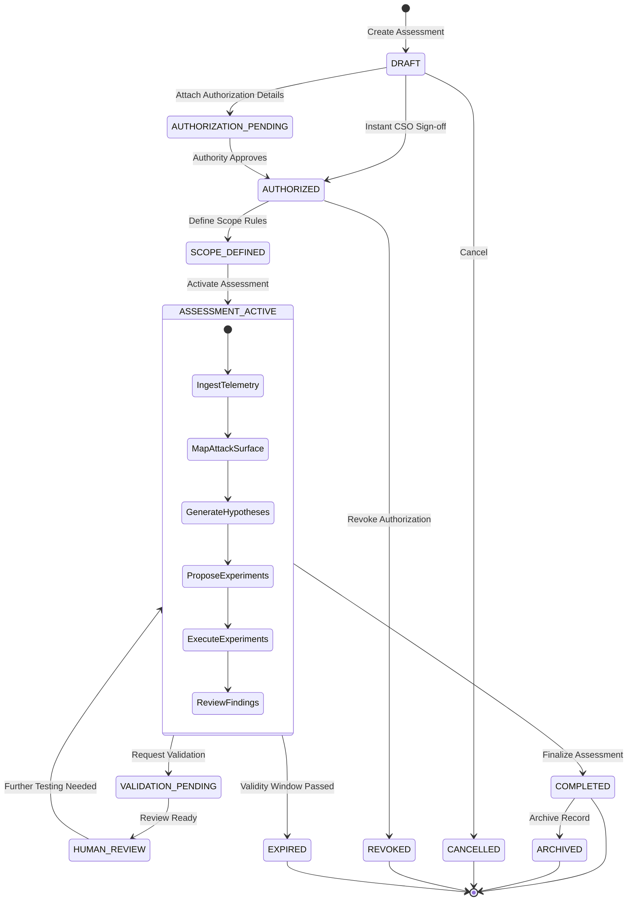

# M13 Assessment Lifecycle and Workflow

## 1. Overview

The Security Assessment Workspace models a comprehensive, 12-stage assessment lifecycle. Testing begins only after formal authorization and scope boundaries are established, proceeds through empirical telemetry collection and hypothesis generation, requires controlled reproduction, and terminates with human verification and executive reporting.

---

## 2. Assessment Lifecycle State Machine

### 2.1. Permitted State Transitions
The state transitions are enforced deterministically by `AssessmentLifecycleEngine`:
- **`DRAFT`**: Initial state upon container creation. No target interaction permitted.
- **`AUTHORIZATION_PENDING`**: Authorization record submitted awaiting sign-off.
- **`AUTHORIZED`**: Formally signed off by authorized personnel (e.g. CSO).
- **`SCOPE_DEFINED`**: In-scope and out-of-scope targets and wildcards configured.
- **`ASSESSMENT_ACTIVE`**: Assessment activated for testing. Target interactions and experiments permitted.
- **`VALIDATION_PENDING` / `HUMAN_REVIEW`**: Findings queued for 13-point human sign-off.
- **`COMPLETED`**: Assessment finalized. Workspace becomes strictly read-only.
- **`ARCHIVED`**: Retained historical record. Read-only audit mode.
- **Terminal Exception States**: `CANCELLED`, `EXPIRED`, `REVOKED`. All target actions immediately fail closed.

---

## 3. Workflow Milestones & Progress Tracker

The `AssessmentWorkflowStatus` model computes real-time milestone progress across 9 phases:

1. **`ESTABLISH_AUTHORIZATION`**: Authorization record is missing, pending, or invalid. Warning banner displayed.
2. **`DEFINE_SCOPE`**: In-scope target definitions must be specified before active testing.
3. **`INGEST_TELEMETRY`**: Import passive HTTP captures, HAR, proxy traffic, or DNS logs.
4. **`MAP_ATTACK_SURFACE`**: Inventory targets, exposed services, endpoints, and admin interfaces.
5. **`ANALYZE_HYPOTHESES`**: Specialized analytical agents synthesize testable hypotheses with identified evidence gaps.
6. **`EXECUTE_EXPERIMENTS`**: Controlled reproduction protocols executed (Plane A safe lab or Plane B manual procedures).
7. **`REVIEW_FINDINGS`**: Candidate findings evaluated against the 13-point deterministic validation checklist.
8. **`GENERATE_REPORT`**: Authoritative assessment report compiled with executive summaries and unverified quarantine.
9. **`ASSESSMENT_COMPLETE`**: All phases successfully executed.

---

## 4. Read-Only Mode & Audit View
When an assessment reaches a terminal state (`COMPLETED`, `ARCHIVED`, `CANCELLED`, `EXPIRED`, `REVOKED`):
- `is_read_only` is set to `True`.
- The UI displays an explicit warning banner indicating read-only audit mode.
- Mutation endpoints (`update_view_state`, `register_artifact`, `import_telemetry`, etc.) block write actions.
- Full access to historical evidence, findings, hypotheses, lineage traces, and audit logs remains intact.
