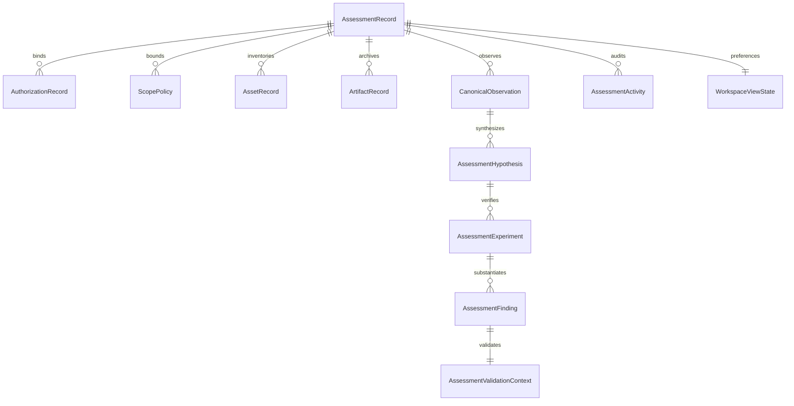

# M13 Assessment Workspace Domain Model

## 1. Domain Entities & Schemas

The M13 domain model defines canonical structures for managing security assessments across the complete lifecycle. All models inherit from Pydantic `BaseModel` with strict type annotations.

### 1.1. AssessmentSection Enum
Represents the 12 primary workspace functional navigation surfaces:
```python
class AssessmentSection(str, Enum):
    OVERVIEW = "OVERVIEW"
    SCOPE_ASSETS = "SCOPE_ASSETS"
    ATTACK_SURFACE = "ATTACK_SURFACE"
    ARTIFACTS = "ARTIFACTS"
    RESEARCH = "RESEARCH"
    HYPOTHESES = "HYPOTHESES"
    EVIDENCE = "EVIDENCE"
    EXPERIMENTS = "EXPERIMENTS"
    FINDINGS_REVIEW = "FINDINGS_REVIEW"
    REPORTS = "REPORTS"
    MEMORY_KNOWLEDGE = "MEMORY_KNOWLEDGE"
    ACTIVITY_AUDIT = "ACTIVITY_AUDIT"
```

### 1.2. AssessmentSummary
Compact entity descriptor used for fast switching in the assessment selector:
- `assessment_id: str`
- `organization: str`
- `assessment_name: str`
- `state: AssessmentLifecycleState`
- `authorization_status: AuthorizationStatus`
- `authorization_type: Optional[AuthorizationType]`
- `created_at: str` (ISO 8601 UTC)
- `updated_at: str` (ISO 8601 UTC)
- `asset_count: int`
- `observation_count: int`
- `hypothesis_count: int`
- `finding_count: int`
- `verified_finding_count: int`
- `last_activity_at: Optional[str]`

### 1.3. AssessmentWorkflowStatus
Deterministic workflow milestone tracker:
- `authorization_valid: bool`
- `scope_defined: bool`
- `telemetry_ingested: bool`
- `attack_surface_mapped: bool`
- `hypotheses_evaluated: bool`
- `experiments_executed: bool`
- `findings_reviewed: bool`
- `report_generated: bool`
- `current_milestone: str` (one of `ESTABLISH_AUTHORIZATION`, `DEFINE_SCOPE`, `INGEST_TELEMETRY`, `MAP_ATTACK_SURFACE`, `ANALYZE_HYPOTHESES`, `EXECUTE_EXPERIMENTS`, `REVIEW_FINDINGS`, `GENERATE_REPORT`, `ASSESSMENT_COMPLETE`)

### 1.4. AssessmentOverview
Consolidated operational read-model for an individual assessment:
- Combines organization, name, lifecycle state, authorization validity window (`valid_from`, `valid_until`), scope boundary metrics (`in_scope_count`, `out_of_scope_count`), asset and observation counts, hypothesis and evidence gap counts, experiment counts, finding counts (`finding_count`, `verified_finding_count`), artifact count (`artifact_count`), and workflow milestone status.

### 1.5. WorkspaceViewState
Per-assessment user interface preference persistence:
- `active_section: AssessmentSection`
- `search_query: str`
- `selected_asset_id: Optional[str]`
- `selected_hypothesis_id: Optional[str]`
- `selected_finding_id: Optional[str]`
- `selected_artifact_id: Optional[str]`
- `filter_severity: Optional[FindingSeverity]`
- `filter_verification: Optional[FindingVerificationStatus]`
- `filter_scope: Optional[AssessmentScopeStatus]`

### 1.6. AssessmentWorkspace
Complete top-level workspace state envelope:
- `overview: AssessmentOverview`
- `view_state: WorkspaceViewState`
- `allowed_sections: List[AssessmentSection]`
- `is_read_only: bool` (set to `True` for terminal states `COMPLETED`, `ARCHIVED`, `CANCELLED`, `EXPIRED`, `REVOKED`)
- `warning_banners: List[str]`

### 1.7. AssessmentActivity
Standardized read-model for audit ledger events:
- `event_id: str`
- `assessment_id: str`
- `timestamp: str`
- `actor: str`
- `component: str`
- `event_type: str`
- `summary: str`
- `details: Dict[str, Any]`
- `authorization_state: str`
- `scope_state: str`
- `epistemic_state: str`

### 1.8. GlobalSearchResultItem
Cross-entity search match descriptor:
- `entity_id: str`
- `entity_type: str` (assessment, asset, artifact, evidence, hypothesis, experiment, finding, memory)
- `title: str`
- `assessment_id: Optional[str]`
- `assessment_name: Optional[str]`
- `snippet: str`
- `provenance: Dict[str, Any]`
- `url_target: str`

---

## 2. Entity Relationship DAG



---

## 3. Epistemic Separation Invariant
The domain model enforces strict classification boundaries across entities:
- `CanonicalObservation` is strictly `OBSERVATION` or `FACT`.
- `AssessmentHypothesis` is strictly `MODEL_HYPOTHESIS`.
- `AgentRecommendation` is strictly `MODEL_REASONING`.
- `AssessmentFinding` is `UNVERIFIED` until signed off as `HUMAN_VERIFIED_FINDING`.
- No entity can promote its own status; status transitions require explicit authoritative actions.
