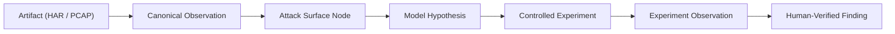

# M13 Evidence Registry and Cryptographic Provenance

## 1. Cryptographic Artifact Management (M8 Integration)

All external files (traffic logs, HAR archives, PCAP captures, decompiled code, binaries) ingested into the assessment workspace are managed by the `ArtifactRegistry`.

### 1.1. Invariants Enforced
- **`M13-12`**: Imported artifacts remain untrusted until appropriately processed and inspected. All new artifacts default to `QuarantineStatus.QUARANTINED`.
- **`M13-13`**: Imported content cannot execute instructions against application policy. Payloads are treated strictly as passive data bytes.
- **`M13-14`**: Artifact identity and evidence provenance cannot be changed through client-side ID substitution. Cryptographic SHA-256 hashes bind each artifact to its raw content.
- **`M13-18`**: Evidence records are append-only and immutable. Historical telemetry cannot be silently modified or overwritten.

### 1.2. Quarantine Workflow
- **`QUARANTINED`**: Initial state for newly imported artifacts. Quarantined artifacts cannot be queried as valid target evidence or used to support confirmed findings.
- **`VALIDATED`**: Promoted by researcher review after structural verification and safety inspection.
- **`REJECTED`**: Artifacts violating safety constraints, corrupted, or containing cross-assessment leakage.

---

## 2. Canonical Telemetry Observations (M6.1 Integration)

Passive network telemetry ingested into an assessment is parsed, normalized, and validated through `TelemetryPipeline`:
- Formats supported: `har`, `burp`, `caido`, `raw_http`, `dns`, `tls`, `pcap`.
- Ingestion checks target scope via `ScopeGate`:
  - In-scope traffic becomes `CanonicalObservation` with `scope_decision = IN_SCOPE`.
  - Out-of-scope traffic is quarantined with `scope_decision = OUT_OF_SCOPE`.
- Each observation receives a deterministic ID based on the SHA-256 hash of its normalized content:
  `OBS-<SHA256_PREFIX>`

---

## 3. Evidence Lineage Graph (DAG)

The `EvidenceLineageGraph` tracks the end-to-end derivation chain from empirical observation to confirmed finding:

### 3.1. Provenance Integrity Invariant
Every confirmed finding MUST possess an unbroken provenance path leading back to valid, in-scope canonical observations. Finding creation without supporting evidence is strictly rejected by `FindingValidator`.
