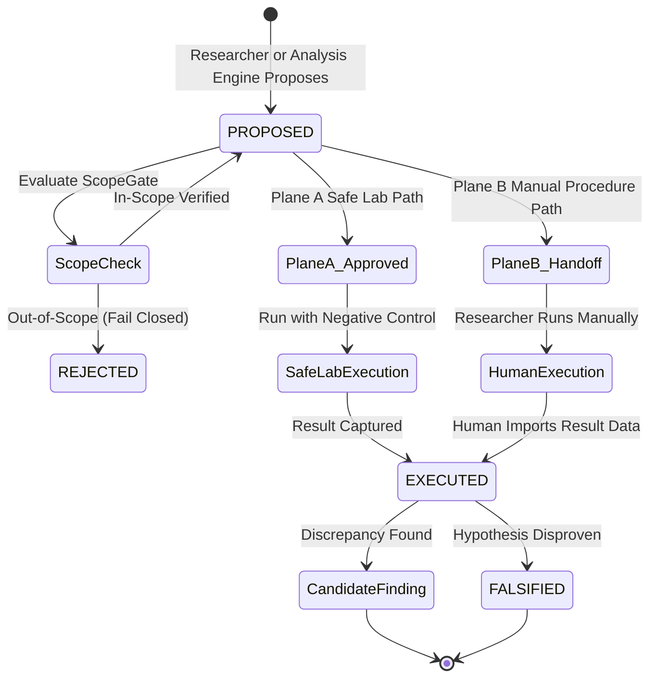

# M13 Experiment Workflow & Dual Execution Planes

## 1. Overview

Testing security hypotheses requires controlled, repeatable reproduction. The workspace enforces a dual-plane architecture:

1. **Plane A: Controlled Lab Runner (Safe Automation)**
2. **Plane B: Manual Researcher Procedures (Strict Zero Autonomous Execution)**

---

## 2. Dual-Plane Comparison

| Dimension | Plane A: Safe Lab Runner | Plane B: Manual Procedures |
| :--- | :--- | :--- |
| **Execution Environment** | Sandboxed internal test harness | External researcher browser, proxy, terminal |
| **Execution Actor** | Automated safe runner with preflight checks | Human researcher exclusively |
| **Autonomous Target Probing** | Strictly prohibited on production targets | Strictly prohibited everywhere |
| **Scope Enforcement** | Hard ScopeGate preflight check before every probe | ScopeGate precheck before generating instructions |
| **Destructive Actions** | Prohibited (fails closed if destructive) | Explicit non-destructive procedure guidelines |
| **Negative Controls** | Required baseline test executed automatically | Required baseline step in manual procedure |
| **Result Ingestion** | Automated capture via test runner hooks | Explicit human researcher import with actor name |
| **Primary Invariants** | `M13-20` (Plane A safety gates) | `M13-21` (Plane B zero autonomous execution) |

---

## 3. Experiment Lifecycle

---

## 4. Safety Invariants Enforced

### 4.1. Invariant M13-20: Plane A Execution Requires All Existing Safety Gates
Before Plane A executes any action:
1. Active authorization must exist (`cont.authorization.status == AUTHORIZED`).
2. Assessment lifecycle must be active (`ASSESSMENT_ACTIVE`).
3. Target must pass `ScopeGate.recheck_scope(target)`. Out-of-scope targets immediately raise `ScopeValidationError`.
4. Risk level must not be destructive (`destructive_potential == False`).
5. Preconditions and expected results must be explicitly defined.

### 4.2. Invariant M13-21: Plane B Cannot Invoke Autonomous Target Execution
1. Plane B generates copyable instructions, curl commands, or HTTP requests for manual execution.
2. The system NEVER invokes or dispatches these commands autonomously.
3. Importing manual results requires specifying the human researcher identity (`executed_by`), which is immutably recorded in the audit trail.

### 4.3. Invariant M13-22: Experiment Success Does Not Automatically Confirm a Vulnerability
Even if an experiment successfully reproduces an anomalous result (e.g. status 200 with Alice's invoice), it does NOT become a confirmed vulnerability. It remains an empirical observation until verified through the authoritative 13-point human review checklist.
