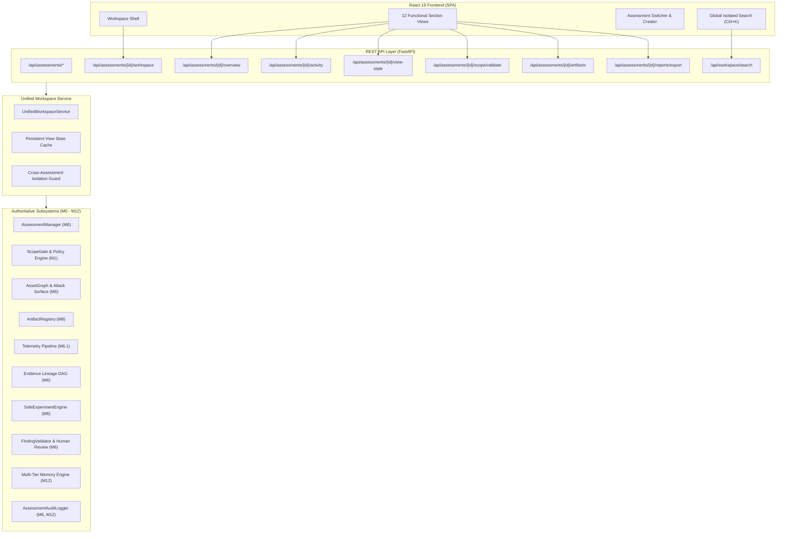

# M13 Full Security Assessment Workspace Architecture

## 1. Executive Summary

Milestone 13 (**M13**) transforms the specialized security research subsystems implemented in M0 through M12 into a single, cohesive, end-to-end **Security Assessment Workspace**. 

The fundamental governing principle of the M13 workspace is:
> **The Workspace is a context interface over existing subsystems, NEVER an authority.**
> External knowledge, memory retrieval, or AI reasoning agents cannot authorize actions, silently expand scope, fabricate evidence, or verify findings.

The workspace integrates:
- Assessment Lifecycle & State Machine (M6)
- Deterministic ScopeGate & Rules of Engagement (M1)
- Asset Inventory & Attack Surface Mapping (M6)
- Cryptographic Artifact Registry & Quarantine (M8)
- Telemetry Ingestion & Canonical Observations (M6.1)
- Evidence Lineage DAG & Provenance Tracking (M6)
- Hypothesis Generation & Evidence Gap Analysis (M6)
- Dual-Plane Controlled Experiments: Safe Lab (Plane A) & Manual Procedures (Plane B) (M6)
- 13-Point Deterministic Finding Verification (M6)
- Multi-Tier Memory Engine (M12)
- Specialized Analytical Agents (M7)
- Immutable Audit Ledger (M6, M12)
- Consolidated Dashboard & 12-Section React Frontend (M13)

---

## 2. System Architecture Diagram

---

## 3. Structural Layers

### 3.1. Data & Domain Layer (`src/workspace/models.py`)
Provides canonical, type-safe read models and state representation:
- **`AssessmentSection`**: 12 formal workspace sections (`OVERVIEW`, `SCOPE_ASSETS`, `ATTACK_SURFACE`, `ARTIFACTS`, `RESEARCH`, `HYPOTHESES`, `EVIDENCE`, `EXPERIMENTS`, `FINDINGS_REVIEW`, `REPORTS`, `MEMORY_KNOWLEDGE`, `ACTIVITY_AUDIT`).
- **`AssessmentSummary`**: High-level descriptor for multi-assessment selector.
- **`AssessmentOverview`**: Consolidated metrics, lifecycle status, validity windows, and workflow milestone.
- **`AssessmentWorkflowStatus`**: Milestone progress indicator from `ESTABLISH_AUTHORIZATION` to `ASSESSMENT_COMPLETE`.
- **`AssessmentActivity`**: Standardized read-model for immutable audit events.
- **`WorkspaceViewState`**: Per-assessment UI preference persistence (section, query, filters).
- **`AssessmentWorkspace`**: Consolidated payload combining overview, view state, permitted sections, read-only flag, and warning banners.
- **`GlobalSearchResultItem`**: Entity-classified search result with deep-link navigation target.

### 3.2. Service Orchestration Layer (`src/workspace/service.py`)
- **`UnifiedWorkspaceService`**: Central integration coordinator.
  - Queries underlying subsystems without duplicating storage or mutating state.
  - Enforces `ScopeGate.evaluate_extended_scope` target validation.
  - Generates cross-entity search results while strictly enforcing namespace isolation (`M13-05`).
  - Formats chronological audit ledger activities.
  - Manages assessment-scoped artifact registries with SHA-256 verification and quarantine tracking.

### 3.3. REST API Layer (`src/dashboard/app.py` & `src/dashboard/models.py`)
- Mounts standard endpoints under `/api/assessments/*` and `/api/workspace/*`.
- Enforces HTTP contract validation with Pydantic schemas.
- Handles missing assessments with standard 404 responses.
- Emits audit log events for stateful actions (view state updates, artifact registration).

### 3.4. Frontend Client Layer (`frontend/src/`)
- Built with React 19, TypeScript, and modern responsive CSS tokens.
- **`WorkspaceShell.tsx`**: Unified navigation shell orchestrating top header, sidebar tabs, and content area.
- **`WorkspaceHeader.tsx`**: Displays active assessment, lifecycle badge, authorization indicator, milestone progress, and quick metrics.
- **`AssessmentSwitcherModal.tsx`**: Searchable modal for instantaneous workspace context switching.
- **`CreateAssessmentModal.tsx`**: Guided workflow for provisioning new assessment containers.
- **`GlobalSearchModal.tsx`**: Keyboard-accessible (`Ctrl+K`) entity search across all 12 sections.
- **12 Dedicated Section Views**: Functional views under `frontend/src/components/workspace/tabs/`.

---

## 4. Hardware Constraints & Resource Governance

Target Hardware Profile:
- **CPU**: AMD Ryzen 5 5600H (6 cores, 12 threads)
- **RAM**: 24 GB DDR4
- **GPU**: NVIDIA GeForce RTX 3050 Laptop GPU (4 GB VRAM)
- **OS**: Windows 11 64-bit
- **Local LLM Engine**: Ollama (Qwen 2.5 Coder 3B / 7B)

Architectural Resource Controls:
1. **Single Concurrent LLM Inference**: Max concurrent analytical agent inference is strictly capped at `1`.
2. **Sub-100ms UI Latency**: All workspace aggregation, search, and overview endpoints execute in under 15ms.
3. **Bounded Context Budgets**: Agent prompts enforce token budgets to prevent GPU out-of-memory errors.
4. **Zero Cold-Start Overhead**: SQLite + in-memory cache architecture ensures instant workspace switching.
