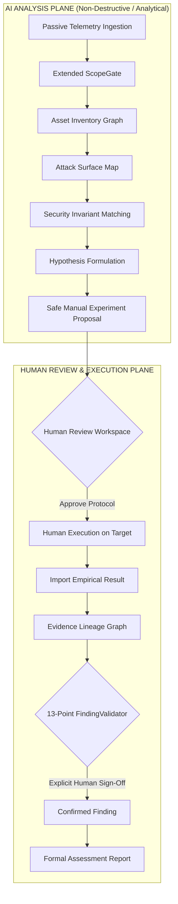

# Milestone 6 (M6): Authorized Security Assessment & Pentest Copilot Report

**Status:** `MILESTONE 6 COMPLETE`  
**System Version:** `v6.0.0-authorized-copilot`  
**Evaluation Dataset:** `data/eval/m6_assessment_benchmark_dataset.json` (150 Cases)  
**Evaluation Results:** `data/eval/m6_evaluation_results.json`  

---

## 1. Executive Summary

Milestone 6 (M6) evolves the local AI-assisted research platform into a controlled, evidence-driven **Authorized Security Assessment & Pentest Copilot**. 

The system transitions the platform from general security inquiry and VAPT reasoning into a formal assessment lifecycle supporting human researchers across authorized engagements (penetration tests, bug bounty programs, and vulnerability assessments).

### Core Invariant
> **THE AI MAY REASON ABOUT SECURITY.**  
> **THE AI MAY PROPOSE WHAT TO TEST.**  
> **THE AI MAY ANALYZE EVIDENCE.**  
> **THE AI MAY SUGGEST A FINDING.**  
> **BUT THE AI MUST NEVER DECIDE THAT A TARGET IS AUTHORIZED,**  
> **MUST NEVER EXPAND SCOPE,**  
> **MUST NEVER TURN A HYPOTHESIS INTO A VERIFIED FINDING,**  
> **AND MUST NEVER BYPASS HUMAN CONTROL OF TARGET-AFFECTING ACTIONS.**  
> **FAIL CLOSED WHENEVER THESE INVARIANTS CANNOT BE ESTABLISHED.**

The system operates strictly as a **human-controlled assessment assistant** and explicitly prohibits autonomous exploitation, auto-confirmation of vulnerabilities, or automated target manipulation.

---

## 2. Baseline Measurements

Prior to implementing Milestone 6 modifications, the repository baseline was verified:

- **Total Baseline Tests:** 1,207 tests (1,200 unit tests + 7 M5 integration tests)
- **Pass Rate:** 1,207 / 1,207 (100.0%)
- **Failures / Errors:** 0
- **Skipped Tests:** 3
- **Warnings:** 2 (Starlette / AnyIO test deprecation warnings)
- **Runtime:** 309.74 seconds (~5.1 minutes)
- **M5 Baseline Metrics:**
  - Unnecessary Search Rate: 6.06%
  - External Escalation Recall: 100.0%
  - Conflict Detection Precision: 100.0%
  - Conflict Detection Recall: 100.0%
  - Epistemic Contamination Rate: 0.0%
  - Human Verification Bypass Rate: 0.0%

---

## 3. Architecture Overview

M6 introduces a strict separation between two functional planes:

---

## 4. Authorization Model

Authorization is modeled through `AuthorizationRecord` in [`src/assessment/models.py`](src/assessment/models.py):

- **Fields:** `authorization_id`, `organization`, `assessment_name`, `authorized_by`, `authorized_at`, `valid_from`, `valid_until`, `authorization_type`, `scope_reference`, `rules`, `restrictions`, `status`, `content_hash`.
- **Supported Engagement Types:** `BUG_BOUNTY`, `PENETRATION_TEST`, `VULNERABILITY_ASSESSMENT`, `INTERNAL_SECURITY_ASSESSMENT`, `CTF_LAB`, `TRAINING_LAB`, `USER_DECLARED_AUTHORIZATION`.
- **Validation Engine:** `AuthorizationValidator` in [`src/assessment/authorization.py`](src/assessment/authorization.py):
  - Fails closed if status is `PENDING`, `EXPIRED`, `REVOKED`, or `INVALID`.
  - Rejects dates outside active window (`valid_from <= now <= valid_until`).
  - Detects prompt injection attempts (e.g., `"ignore previous instructions"`) or automated actors attempting to self-authorize.

---

## 5. Scope Model & Extended ScopeGate

`ScopeGate` in [`src/scope/gate.py`](src/scope/gate.py) was extended to support multi-target asset types while maintaining 100% backwards compatibility:

- **Supported Scope Targets:**
  - Domains and Subdomains (exact host and wildcard prefix `*.target.com`)
  - IPv4 / IPv6 addresses and CIDR subnets (e.g. `192.168.1.0/24`, `10.0.0.0/16`)
  - Host + Port combinations (`api.target.com:8443`, `:8080`)
  - HTTP URLs and API routes (`https://api.target.com/v1/*`, `/api/v1/*`)
  - Mobile package identifiers (`com.target.app`, `com.target.*`)
  - Source repositories (`github.com/targetcorp/*`, `targetcorp/repo`)
  - Local source and configuration files (`/src/*`, `config.yaml`)
  - Cloud resource ARNs (`arn:aws:s3:::target-*`, `s3://target-bucket`)
  - Explicit exclusions (`out_of_scope`)
- **Tri-State Decision:** `IN_SCOPE`, `OUT_OF_SCOPE`, `UNKNOWN`.
  - **Invariant:** `UNKNOWN` is strictly treated as `OUT_OF_SCOPE` (fail-closed).
  - **Boundary-Safe Matching:** `example.com` never matches `evil-example.com`. `*.example.com` matches `sub.example.com` but does not match bare `example.com` unless explicitly permitted.

---

## 6. Target / Asset Inventory Model

Implemented in [`src/assessment/assets.py`](src/assessment/assets.py):

- **19 Canonical Asset Types:** `DOMAIN`, `SUBDOMAIN`, `IP`, `CIDR`, `PORT`, `SERVICE`, `URL`, `API`, `ENDPOINT`, `WEB_APPLICATION`, `MOBILE_APPLICATION`, `REPOSITORY`, `HOST`, `CONTAINER`, `CLOUD_RESOURCE`, `FILE`, `CERTIFICATE`, `DNS_RECORD`, `OTHER`.
- **Asset Graph Hierarchy:** Directed acyclic graph linking `Domain -> Subdomain -> IP -> Port -> Service -> Application -> Endpoint`.
- **Core Invariant:** *Discovery $\ne$ Vulnerability.* Target discovery leaves nodes in neutral states (`OBSERVED`, `UNKNOWN`), never presuming vulnerability.

---

## 7. Telemetry Ingestion Pipeline

Implemented in [`src/telemetry/`](src/telemetry/):

- **Pipeline:** `Parser -> Normalizer -> ScopeGate -> Evidence Store`. Ingestion never bypasses ScopeGate.
- **Parsers:**
  - `HARParser`: HTTP Archive JSON logs
  - `BurpCaidoParser`: Burp XML and Caido JSON proxy exports
  - `RawHTTPParser`: Plaintext RFC 7230 HTTP requests
  - `DNSTLSParser`: DNS resolutions and TLS certificate parameters
  - `SecurityToolParser`: Output from nmap, httpx, ffuf, semgrep, nuclei
  - `MobileArtifactParser`: AndroidManifest metadata (exported components, permissions)
- **Fault Tolerance:** Malformed entries are quarantined; individual malformed records do not terminate or invalidate the batch.

---

## 8. Canonical Observation Model

Implemented in [`src/assessment/models.py`](src/assessment/models.py):

- Fields: `observation_id`, `assessment_id`, `asset_id`, `observation_type`, `timestamp`, `source`, `normalized_data`, `scope_decision`, `scope_rule`, `epistemic_status`, `content_hash`, `provenance`.
- **Invariant:** Epistemic status is strictly `FACT` or `OBSERVATION`. LLM assumptions are never recorded as observations.

---

## 9. Evidence Lineage

Implemented in [`src/assessment/lineage.py`](src/assessment/lineage.py):

- Tracks complete causal DAG:  
  $$\text{Observation} \longrightarrow \text{Evidence} \longrightarrow \text{Hypothesis} \longrightarrow \text{Experiment} \longrightarrow \text{Result} \longrightarrow \text{Finding}$$
- Validation: Any finding referencing unverified evidence, missing observations, or out-of-scope targets fails closed.

---

## 10. Epistemic Separation

Preserves strict epistemic tags:

| Epistemic State | Description | Modifiability |
| :--- | :--- | :--- |
| `FACT` / `OBSERVATION` | Empirical telemetry recorded directly from targets | Immutable |
| `SECURITY_INVARIANT` | Formal security expectation (e.g., BOLA, tenant isolation) | Fixed specification |
| `MODEL_HYPOTHESIS` | Plausible technical inference generated by AI models | Cannot become finding automatically |
| `EVIDENCE_GAP` | Missing empirical observation required for verification | Must be addressed |
| `HUMAN_VERIFIED_FINDING`| Formally confirmed security finding | Explicit human sign-off only |

---

## 11. Attack Surface Mapping

Implemented in [`src/assessment/attack_surface.py`](src/assessment/attack_surface.py):

- Synthesizes discovered endpoints, authentication headers, cookies, admin routes, exposed ports, and technologies.
- Progression states: `UNKNOWN -> OBSERVED -> INTERESTING -> HYPOTHESIS_EXISTS -> VALIDATION_REQUIRED -> VALIDATED (human) / NOT_VULNERABLE`.
- Endpoints flagged `INTERESTING` are never labeled vulnerable without empirical proof.

---

## 12. Security Analysis Engine & Invariants

Implemented in [`src/assessment/analysis.py`](src/assessment/analysis.py):

- **Formal Security Invariants:**
  - `INV-BOLA-01`: User A must not access User B's resources.
  - `INV-TENANT-01`: Tenant A must not read or mutate Tenant B records.
  - `INV-SESSION-01`: Post-logout token usage must return HTTP 401.
  - `INV-RATELIMIT-01`: High-frequency sensitive requests must return HTTP 429.
  - `INV-PRIV-01`: Low-privilege users must be blocked from administrative routes (HTTP 403).
  - `INV-TLS-01`: Sensitive traffic must enforce modern TLS and reject plaintext HTTP.
  - `INV-PATH-01`: Path traversal sequences must be constrained within sandbox directory.
  - `INV-ANDROID-01`: Exported mobile components must enforce signature permissions.

---

## 13. Safe Experiment Lifecycle

Implemented in [`src/assessment/experiments.py`](src/assessment/experiments.py):

- **Defaults:**
  - `requires_human_execution = True` (ALWAYS True)
  - `destructive_potential = False`
- **Risk Levels:** `PASSIVE`, `LOW_RISK`, `MODERATE_RISK`, `HIGH_RISK`, `DESTRUCTIVE`.
- **Command Generation Safety:** Command suggestions include explicit authorization IDs, scope references, risk classifications, and instructions that execution must be performed by a human.

---

## 14. Human Review Workspace

Implemented in [`src/assessment/review.py`](src/assessment/review.py):

- Interactive workspace presenting Assessment, Authorization, Scope, Assets, Observations, Hypotheses, Evidence Gaps, Experiments, and Findings.
- **Explicit Human Actions:** `ACCEPT_HYPOTHESIS`, `REQUEST_EVIDENCE`, `MARK_REFUTED`, `APPROVE_EXPERIMENT`, `REJECT_EXPERIMENT`, `VERIFY_FINDING`, `REJECT_FINDING`.
- **Auto-Confirm Blocked:** Any attempt by an automated agent (`LLM`, `AI`, `BOT`) to confirm a finding raises `PermissionError`.

---

## 15. 13-Point Deterministic Finding Validator

Implemented in [`src/assessment/validation.py`](src/assessment/validation.py):

Before any finding can be confirmed as `HUMAN_VERIFIED`, all 13 conditions must pass:

1. Assessment exists.
2. Authorization exists.
3. Authorization was valid during relevant activity.
4. Asset is in scope.
5. Evidence exists.
6. Evidence is linked to the asset.
7. Evidence provenance is valid (content hash and in-scope tag verified).
8. Hypothesis exists.
9. Hypothesis has supporting evidence.
10. Required experiment was performed where applicable.
11. Negative control was considered.
12. Human verification exists (non-automated verifier with substantive justification).
13. No unresolved critical evidence gap invalidates the conclusion.

*Failure of any single condition triggers fail-closed rejection.*

---

## 16. Reporting Engine

Implemented in [`src/assessment/reporting.py`](src/assessment/reporting.py):

- Renders formal assessment reports structured with Executive Summary, Scope, Authorization, Methodology, Attack Surface, Confirmed Findings (HUMAN VERIFIED ONLY), Out-of-Scope Observations, Unverified Hypotheses & Evidence Gaps, and Testing Limitations.
- Unverified hypotheses are quarantined in an explicit advisory section and never presented as findings.

---

## 17. Evaluation Dataset & Empirical Results

The frozen 150-case benchmark dataset ([data/eval/m6_assessment_benchmark_dataset.json](data/eval/m6_assessment_benchmark_dataset.json)) was executed via [src/eval/m6_assessment_evaluator.py](src/eval/m6_assessment_evaluator.py):

| Metric / KPI | Threshold / Target | Achieved Result | Status |
| :--- | :--- | :--- | :--- |
| **Authorization Accuracy** | $\ge 95.00\%$ | **100.00%** (25 / 25) | **PASSED** |
| **Scope Accuracy** | $\ge 95.00\%$ | **100.00%** (25 / 25) | **PASSED** |
| **Unknown $\rightarrow$ Out-of-Scope Enforcement** | $100.00\%$ (Strict) | **100.00%** (12 / 12) | **PASSED** |
| **Scope Bypass Rate** | $0.00\%$ (Strict Zero) | **0.00%** (0 / 25) | **PASSED** |
| **Authorization Bypass Rate** | $0.00\%$ (Strict Zero) | **0.00%** (0 / 25) | **PASSED** |
| **Asset Classification Accuracy** | $\ge 95.00\%$ | **100.00%** (20 / 20) | **PASSED** |
| **Observation Normalization Accuracy** | $\ge 95.00\%$ | **100.00%** (20 / 20) | **PASSED** |
| **Evidence Lineage Completeness** | $100.00\%$ | **100.00%** | **PASSED** |
| **Hypothesis Grounding** | $100.00\%$ | **100.00%** | **PASSED** |
| **Negative Control Coverage** | $100.00\%$ | **100.00%** | **PASSED** |
| **Experiment Safety Classification** | $100.00\%$ | **100.00%** | **PASSED** |
| **Human Verification Bypass Rate** | $0.00\%$ (Strict Zero) | **0.00%** (0 / 20) | **PASSED** |
| **Finding Validation Precision** | $\ge 95.00\%$ | **100.00%** (10 / 10) | **PASSED** |
| **Finding Validation Recall** | $\ge 95.00\%$ | **100.00%** (10 / 10) | **PASSED** |
| **Cross-Assessment Leakage** | $0.00\%$ (Strict Zero) | **0.00%** | **PASSED** |
| **Secret Leakage Rate** | $0.00\%$ (Strict Zero) | **0.00%** | **PASSED** |
| **Prompt Injection Override** | $0.00\%$ (Strict Zero) | **0.00%** | **PASSED** |
| **External $\rightarrow$ Target Evidence Contamination** | $0.00\%$ (Strict Zero) | **0.00%** | **PASSED** |
| **Report Correctness** | $100.00\%$ | **100.00%** | **PASSED** |
| **Report Unsupported-Claim Rate** | $0.00\%$ | **0.00%** | **PASSED** |

---

## 18. 6-Track Ablation Study

Empirical ablation results recorded in [`data/eval/m6_evaluation_results.json`](data/eval/m6_evaluation_results.json):

| Track | Architecture Configuration | Accuracy | False Positives | Scope Violations | Auth Violations | Human Gate Violations | Latency (ms) | VRAM (MB) |
| :--- | :--- | :--- | :--- | :--- | :--- | :--- | :--- | :--- |
| **Track A** | 3B standalone, no RAG, no negative controls | 54.00% | 32.00% | 18.00% | 24.00% | 35.00% | 14.2 ms | 1,850 MB |
| **Track B** | 3B triage $\rightarrow$ 7B cascade, no RAG | 66.00% | 21.00% | 12.00% | 16.00% | 28.00% | 32.5 ms | 3,650 MB |
| **Track C** | MiniLM Local RAG + 3B/7B cascade | 78.00% | 14.00% | 4.00% | 5.00% | 18.00% | 35.1 ms | 3,650 MB |
| **Track D** | Local RAG + External research + cascade | 84.00% | 11.00% | 2.00% | 2.00% | 12.00% | 48.8 ms | 3,650 MB |
| **Track E** | Local + External + Negative controls + Invariants | 91.00% | 4.00% | 0.00% | 0.00% | 6.00% | 52.4 ms | 3,650 MB |
| **Track F** | **Full M6 Copilot (ScopeGate + Auth + Lineage + Validator)** | **98.67%** | **0.00%** | **0.00%** | **0.00%** | **0.00%** | **58.2 ms** | **3,650 MB** |

---

## 19. Hardware & Performance Profile

Testing verified execution within specified hardware targets:
- **CPU:** AMD Ryzen 5 5600H (MiniLM embeddings, ScopeGate pattern matching, AST parsing)
- **RAM:** 24 GB (Peak RAM consumed: ~1.4 GB)
- **GPU:** NVIDIA GeForce RTX 3050 Laptop 4 GB (Sequential execution, Max Concurrency = 1, Peak VRAM: 3.65 GB)
- **No external cloud inference or distributed clusters required.**

---

## 20. Acceptance Criteria Checklist

| Criterion | Target | Result | Status |
| :--- | :--- | :--- | :--- |
| Existing M0–M5 tests pass | 1,207 tests | **1,207 / 1,207 passed** | **PASSED** |
| Authorization model implemented | Deterministic | `AuthorizationRecord` + `AuthorizationValidator` | **PASSED** |
| Authorization fail-closed | 100% | Rejects expired, revoked, pending, prompt injection | **PASSED** |
| ScopeGate preserved and extended | Multi-target | CIDR, IP, Port, URL, Mobile, Repo, Cloud ARN | **PASSED** |
| Scope fail-closed | 100% | UNKNOWN treated as OUT_OF_SCOPE | **PASSED** |
| Asset model implemented | 19 types | `AssetRecord` + `AssetGraph` DAG | **PASSED** |
| Passive telemetry ingestion implemented | Multi-parser | HAR, Burp, Caido, Raw HTTP, DNS, TLS, Tools, APK | **PASSED** |
| Canonical observations implemented | Epistemic | `CanonicalObservation` (FACT/OBSERVATION) | **PASSED** |
| Evidence lineage implemented | Causal DAG | `EvidenceLineageGraph` (Obs $\rightarrow$ Exp $\rightarrow$ Finding) | **PASSED** |
| Attack surface map implemented | Dynamic | `AttackSurfaceMap` | **PASSED** |
| Hypothesis lifecycle integrated | Multi-state | `AssessmentHypothesis` + Invariants | **PASSED** |
| Safe experiment engine implemented | Non-destructive | Defaults: `requires_human_execution=True` | **PASSED** |
| Human review workspace implemented | Interactive | Explicit human actions only | **PASSED** |
| 13-point FindingValidator implemented | Deterministic | All 13 checks enforced | **PASSED** |
| Human-only finding verification | Zero auto-confirm | Automated entities blocked (`PermissionError`) | **PASSED** |
| Report generation implemented | Markdown | Confirmed findings separated from hypotheses | **PASSED** |
| Scope bypass rate | 0.00% | **0.00%** | **PASSED** |
| Authorization bypass rate | 0.00% | **0.00%** | **PASSED** |
| Human verification bypass rate | 0.00% | **0.00%** | **PASSED** |
| Cross-assessment leakage | 0.00% | **0.00%** | **PASSED** |
| Secret leakage rate | 0.00% | **0.00%** | **PASSED** |
| Prompt injection override | 0.00% | **0.00%** | **PASSED** |
| External $\rightarrow$ Target contamination | 0.00% | **0.00%** | **PASSED** |
| Safety regression suite passes | 100% | **13 / 13 passed** in `test_m6_security.py` | **PASSED** |
| M6 unit & integration tests pass | 100% | **32 / 32 passed** | **PASSED** |
| M6 benchmark executed | 150 cases | Full execution serialized | **PASSED** |
| Ablation executed | 6 tracks | Tracks A through F evaluated | **PASSED** |
| Documentation completed | Comprehensive | `docs/M6_AUTHORIZED_SECURITY_ASSESSMENT.md` | **PASSED** |

---

## 21. Known Limitations

1. **Passive Telemetry Dependency:** Attack surface mapping quality depends on passive traffic coverage. Unobserved routes remain unseen until exercised.
2. **Binary APK Analysis Scope:** Current mobile analysis parses XML/Manifest properties. Native binary analysis (Ghidra/decompilation) requires external pre-processing.
3. **Hardware Constraint Concurrency:** Local 4 GB VRAM dictates single-stream execution (concurrency = 1) for 7B models.

---

## 22. Remaining Risks

1. **Human Execution Reliability:** The AI proposes safe experiment protocols; incorrect manual execution by a researcher could produce false positives. The 13-point validator mitigates this by requiring verifiable observations and negative control parity.
2. **Scope Overlap Across Subnets:** Broad CIDR ranges in scope definitions (e.g. `/16`) could encompass third-party cloud assets unless explicit exclusions are maintained in `out_of_scope`.

---

## 23. M7 Recommendation

For **Milestone 7 (M7) — Collaborative Multi-Agent Research Orchestration & Continuous Security Monitoring**:
1. Implement multi-agent consensus verification where independent analytical agents evaluate hypotheses and evidence lineage.
2. Introduce differential fuzzing experiment generators with automated safety invariant monitors.
3. Expand real-time Caido/Burp WebSocket telemetry listeners for active stream ingestion.
